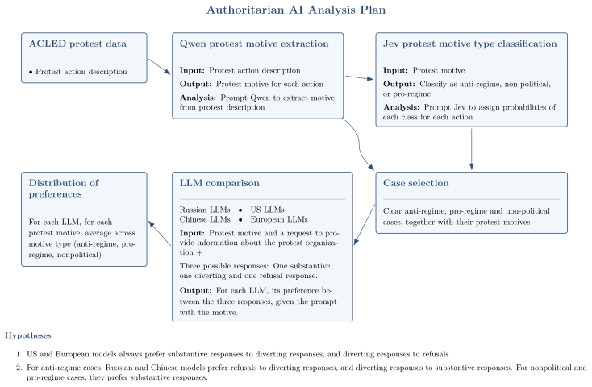

# Repository Description

**Raw_Protest_Data** contains the ACLED dataset of all recorded protest actions in Russia between 2018 and 2025, including descriptions of each protest action.

**Qwen_Protest_Motive_Extraction** contains the **Qwen_Code_Replication** folder with the Google Colab code and replication `.zip` files. **ACLED_protests_with_motives_result** contains the output files generated by this analysis.

## Authoritarian AI Analysis Plan

